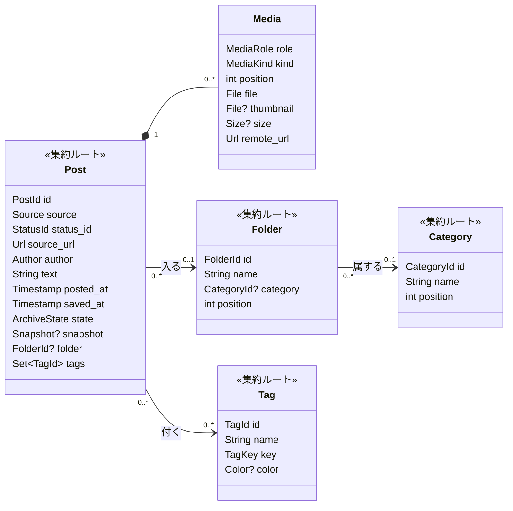
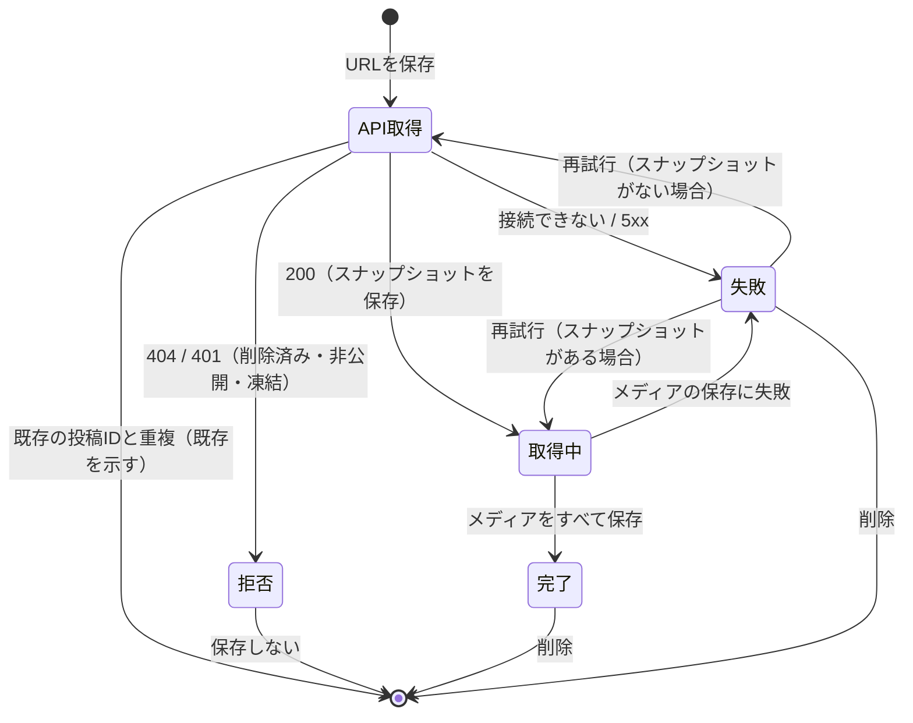

# arcman ドメインモデル（MVP）

[要件定義書](requirements.md) をもとにしたドメインモデル。用語はこの文書の「ユビキタス言語」にそろえ、コードの型名は括弧内の英語名を使う。

## 1. ユビキタス言語

| 用語 | 英語名 | 意味 |
|---|---|---|
| 投稿 | Post | arcman が保存した x.com の投稿か YouTube の動画1件。保存の単位であり、削除の単位 |
| 取得元 | Source | 投稿がどのサイトのものか。`x` か `youtube` |
| 投稿ID | StatusId | x.com 上の投稿の ID（数字の文字列）か、YouTube の動画 ID（11文字）。URL の形式が違っても同じ投稿なら同じ値になる |
| スナップショット | Snapshot | 保存した時点で fxtwitter API（YouTube は oEmbed）が返した JSON。丸ごと保存し、後から変更しない |
| 取得状態 | ArchiveState | 投稿のアーカイブがどこまで進んだか。取得中、完了、失敗のいずれか |
| メディア | Media | 投稿に属する、ローカルに保存したファイル1つ（画像、動画、GIF） |
| 役割 | MediaRole | そのメディアが投稿のどこに現れるか。本体、引用元、投稿者アイコン、リンクカード、X記事 |
| タイル | Tile | ギャラリーの表示単位。本体のメディア1つで1枚。メディアがない投稿は本文のタイル1枚 |
| フォルダ | Folder | 投稿の入れ物。1件の投稿は最大1つのフォルダに入る |
| 未分類 | Unsorted | どのフォルダにも入っていない状態 |
| カテゴリ | Category | フォルダをまとめる見出し。入れ子はない |
| タグ | Tag | 投稿に複数付けられるラベル。表記ゆれを吸収した「タグキー」で同一性を判断する |
| タグキー | TagKey | タグ名を正規化した値（NFKC、前後の空白と先頭の `#` を除去、小文字化） |
| 設定 | Settings | Web の設定画面で変えられる値。画面で保存した値、環境変数、既定値の順に優先する |
| セッション | Session | ログインした端末1つ分の認証状態。有効期限は30日 |

## 2. 集約



| 集約 | 境界に含むもの | 主な不変条件 |
|---|---|---|
| 投稿 | 投稿、メディア、タグの付け外し | 投稿IDは全投稿で一意（x.com と YouTube の ID は形が違うので重ならない）。完了した投稿はスナップショットを持つ。メディアは投稿と一緒に作られ、一緒に消える |
| フォルダ | フォルダ | 名前は空にできない（重複は許す）。カテゴリは任意 |
| カテゴリ | カテゴリ | 名前は空にできない |
| タグ | タグ | タグキーは全タグで一意。名前を変えて既存のタグキーと衝突したら拒否する（統合はしない） |

認証（パスワードハッシュ1件とセッション）と設定は、業務の中心ではない補助的なモデルとして扱う。

## 3. 値オブジェクト

- **投稿ID（StatusId）**: 受け付ける URL から取り出す。ホストは `x.com`、`twitter.com`、`mobile.twitter.com`、`fixupx.com`、`fxtwitter.com`、`vxtwitter.com`。パスは `/{screen_name}/status/{id}`（`/i/status/{id}` と `statuses` も可）。クエリとフラグメントは無視する
- **投稿ID（YouTube）**: `youtube.com` の `/watch?v=`、`/shorts/`、`/live/`、`/embed/`、`/v/` と `youtu.be/` から取り出す。ショートかどうかは保存した URL から判断する
- **投稿者（Author）**: スクリーンネーム、表示名。アイコンはメディア（役割: 投稿者アイコン）として持つ。YouTube はチャンネルのハンドル（なければチャンネルURLの最後の部分）と名前で、本文はタイトル
- **取得状態（ArchiveState）**: 取得中（Pending）、完了（Done）、失敗（Failed）。失敗には理由（API に接続できない、メディアのダウンロードに失敗した）を持つ
- **メディアの種類（MediaKind）**: 画像（Photo）、動画（Video）、GIF（Gif）
- **メディアの役割（MediaRole）**: 本体（Main）、引用元（Quote）、投稿者アイコン（Avatar）、引用元の投稿者アイコン（QuoteAvatar）、リンクカード（Card）、X記事（Article）
- **タグキー（TagKey）**: 上の表の正規化規則で作る
- **色（Color）**: `#rrggbb`

## 4. 投稿のライフサイクル



- API の取得は保存の操作の中で同期的に行う。これで、削除済みの投稿を保存せずにその場でエラーにできる（CAP-06）
- メディアの保存はバックグラウンドで1件ずつ順番に行う（CAP-10）。サーバーを再起動したら、取得中の投稿を最初から保存し直す
- 引用元が削除済みや非公開でも、本体の取得は成功として扱う（CAP-07）

## 5. タイルの導出（読み取りモデル）

タイルは保存しない。投稿とメディアから次の規則で作る。

| 投稿の状態 | タイル |
|---|---|
| 取得中 | 「取得中」のタイル1枚 |
| 失敗 | 「失敗」のタイル1枚 |
| 完了で、本体のメディアがある | 本体のメディア1つにつき1枚（画像、動画、GIF）。投稿内の何枚目か（例: 1/4）を持つ |
| 完了で、YouTube の動画 | サムネイルとタイトルのタイル1枚 |
| 完了で、本体のメディアがない | 本文のタイル1枚（リンクカードの画像があっても本文のタイル。GAL-07） |

並び順は保存日時（昇順か降順）、同じ投稿の中ではメディアの並び順。

## 6. 主な操作と規則

| 操作 | 規則 |
|---|---|
| 投稿を保存する | URL ごとに投稿IDを取り出し、重複なら既存を返す。保存先のフォルダは呼び出し側が渡す（未指定なら未分類） |
| 投稿を削除する | 投稿、メディアのファイル、タグの付け外しを消す |
| 投稿を別のフォルダに移す | フォルダは1つだけ。未分類に戻すこともできる |
| タグを付ける | 名前からタグキーを作り、既存のタグがあればそれを、なければ新しく作って付ける |
| タグの名前を変える | 新しいタグキーが他のタグと衝突したら拒否する |
| タグを削除する | 投稿からも外れる。投稿は消えない |
| フォルダを削除する | 中の投稿もすべて削除する |
| カテゴリを削除する | 中のフォルダはカテゴリなしになる |
| 並べ替える | カテゴリの並び、カテゴリごとのフォルダの並びを、ID の列でまとめて置き換える |
| 検索する | キーワード（本文とタグ名の部分一致）、フォルダ（すべて、未分類、特定のフォルダ）、タグ（AND）、保存日時の期間、メディアの種類、投稿者で絞り込む |

## 7. 保存先

すべて `~/.arcman/`（環境変数 `ARCMAN_HOME` で変更可）に置く。このディレクトリをコピーすればバックアップになる。

```
~/.arcman/
├── arcman.db          SQLite。投稿、メディア、フォルダ、カテゴリ、タグ、設定、認証
└── media/
    └── {post_id}/     投稿ごとのメディアファイル
```
